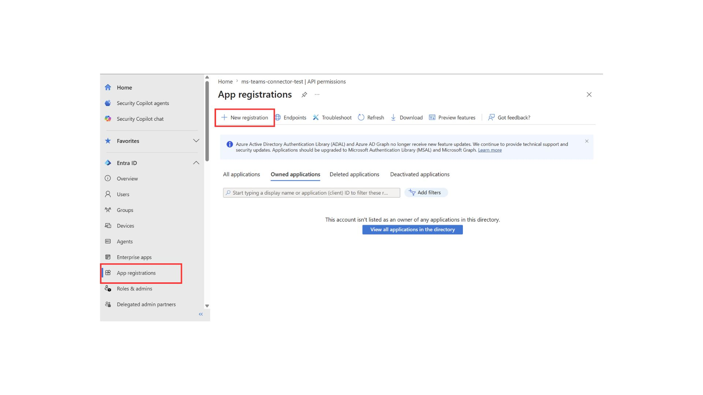
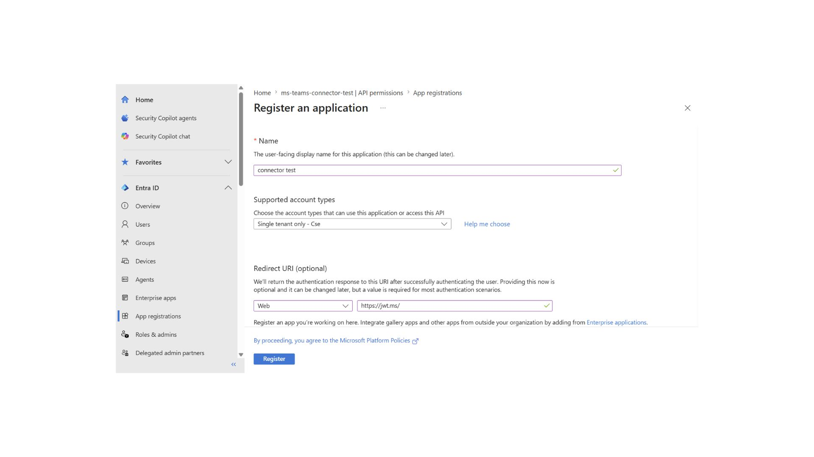
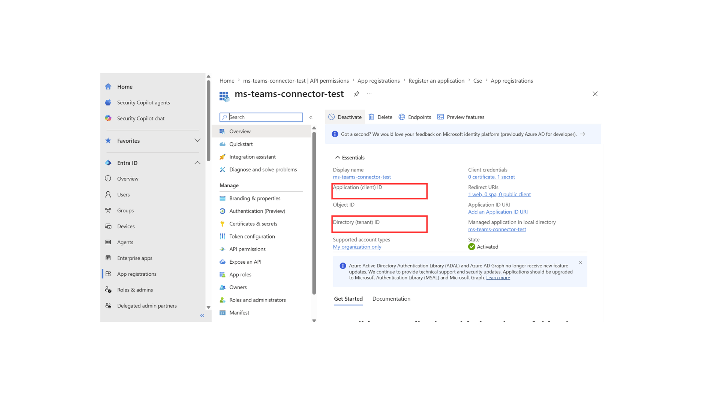
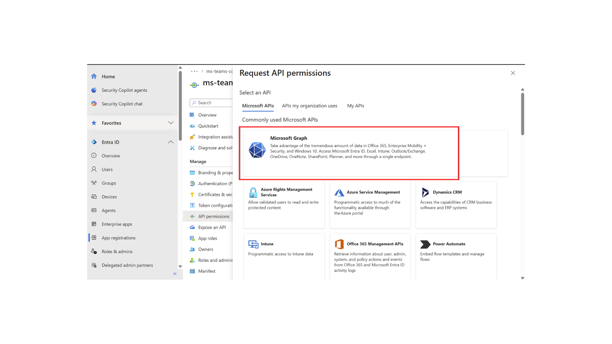
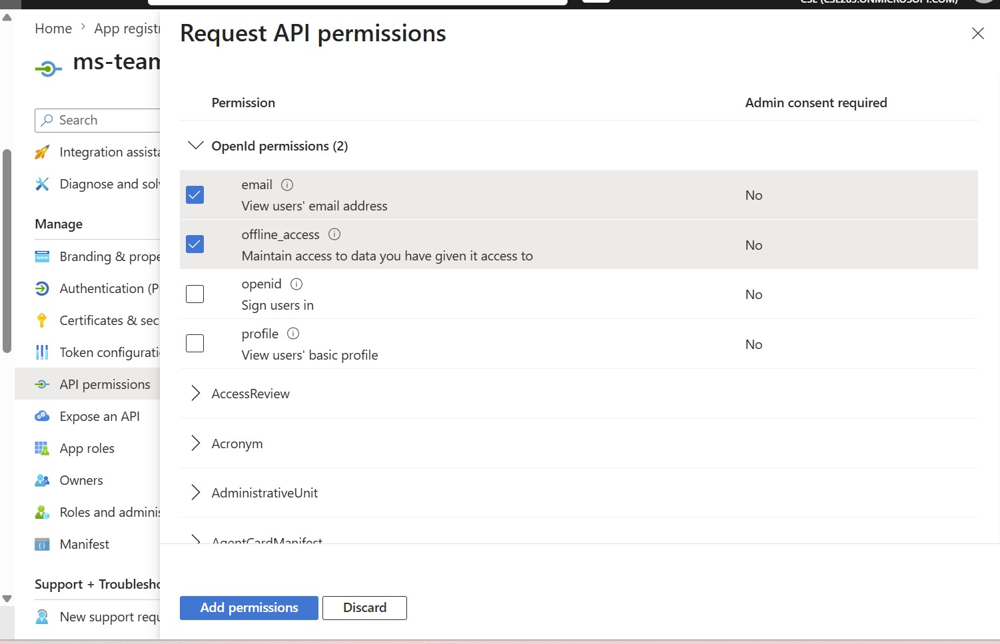
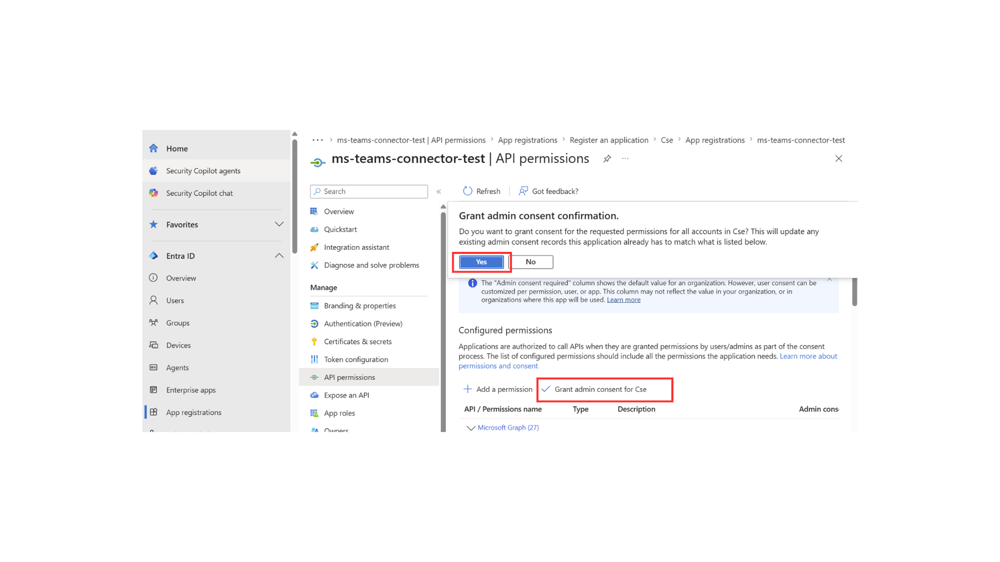
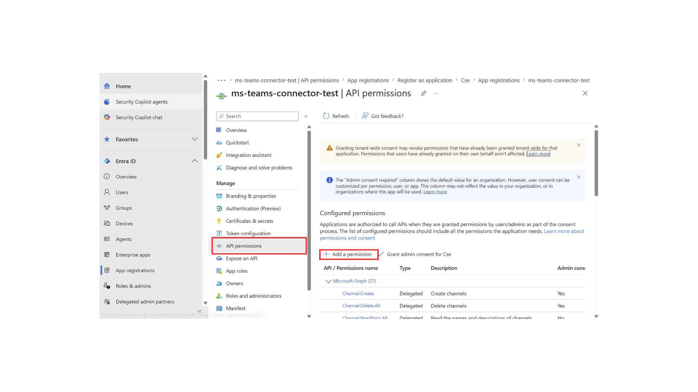
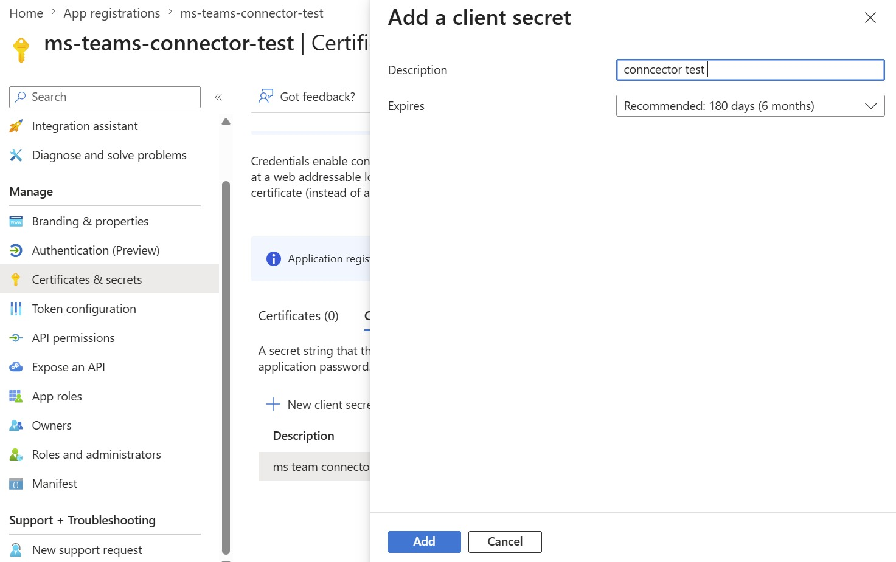
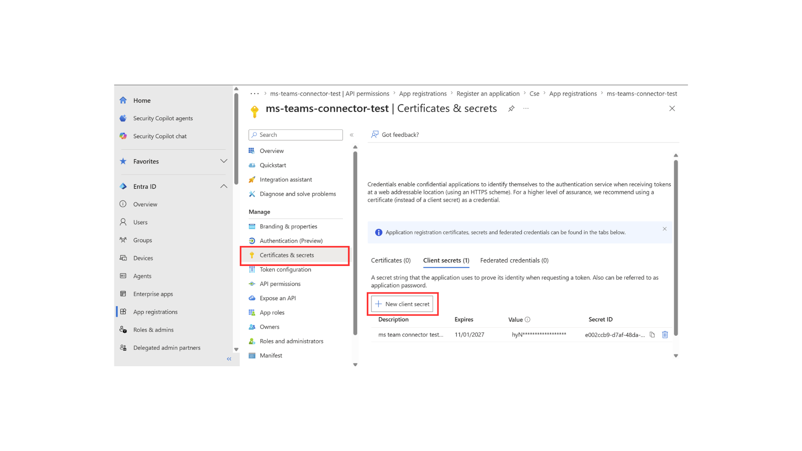

# Ballerina Microsoft OneNote connector

[](https://github.com/ballerina-platform/module-ballerinax-microsoft.onenote/actions/workflows/ci.yml)
[](https://github.com/ballerina-platform/module-ballerinax-microsoft.onenote/commits/main)
[](https://github.com/ballerina-platform/ballerina-library/labels/module%2Fmicrosoft.onenote)

## Overview

[Microsoft OneNote](https://learn.microsoft.com/en-us/graph/integrate-with-onenote) is the digital note-taking application of Microsoft 365. Through Microsoft Graph it exposes users' notebooks, section groups, sections and pages, together with the page content and the resources embedded in it.

The Microsoft OneNote connector lets Ballerina applications manage the notebooks of the signed-in user and of other users in the organization, organize them into section groups and sections, read and update page content, and copy notebooks, sections and pages. It supports version 1.0 of the Microsoft Graph REST API.

## Setup guide

To use the Microsoft OneNote connector, you need a Microsoft 365 or Outlook.com account and an application registered in Microsoft Entra ID.

> **Note:** The screenshots in this guide are for illustration only. The Microsoft Entra admin center changes over time, so treat them as a visual reference rather than an exact match — follow the described actions and choose the values (application name, redirect URI, permissions, and so on) that fit your own scenario.

### Step 1: Register an application in Microsoft Entra ID

1. Sign in to the [Microsoft Entra admin center](https://entra.microsoft.com).
2. Navigate to **Entra ID** > **App registrations** and click **New registration**.

   

3. Enter a name of your choice and select the supported account types: accounts in your organization only, or accounts in any organization and personal Microsoft accounts if Outlook.com users must be able to sign in. Under **Redirect URI**, select the **Web** platform and enter the URI that receives the authorization code (a Microsoft-hosted page such as `https://jwt.ms` is a convenient choice for Step 4). The **Web** platform is required because the connector redeems the code using a client secret (a confidential-client flow); the public "Mobile and desktop applications" platform does not accept a client secret. Click **Register**.

   

4. On the app's **Overview** page, note the **Application (client) ID** and **Directory (tenant) ID**.

   

### Step 2: Add Microsoft Graph permissions

1. In the registered application, go to **API permissions** > **Add a permission** > **Microsoft Graph**.

   

2. Choose **Delegated permissions** and add the following permissions, then click **Add permissions**:

   - `Notes.ReadWrite` to read and write the signed-in user's notebooks
   - `Notes.Create` to create notebooks, sections and pages in the signed-in user's account
   - `Notes.ReadWrite.All` to read and write notebooks that other users have shared with the signed-in user (needed for the operations under `users/{userId}`)
   - `offline_access` so that the token response includes a refresh token

   

3. If your organization requires administrator consent, click **Grant admin consent for \<your tenant\>** on the **API permissions** page and confirm **Yes**.

   

4. Confirm the permissions are listed under **Configured permissions**, with **Granted for \<your tenant\>** in the **Status** column if you granted admin consent.

   

### Step 3: Create a client secret

1. Go to **Certificates & secrets** > **New client secret**, add a description and an expiry, and click **Add**.

   

2. Copy the secret **Value** immediately — it is shown only once. (The **Secret ID** shown next to it is just a label for the secret, not a credential.)

   

### Step 4: Obtain a refresh token

OneNote in Microsoft Graph does not support application-only access, so every operation runs on behalf of a signed-in user and the connector authenticates with a refresh token.

Microsoft Entra's v2.0 endpoints for the app registered above:

- Authorize: `https://login.microsoftonline.com/<TENANT>/oauth2/v2.0/authorize`
- Token: `https://login.microsoftonline.com/<TENANT>/oauth2/v2.0/token`

Replace `<TENANT>` with your **Directory (tenant) ID** if the application accepts accounts in your organization only, or with `common` if it also accepts other organizations and personal Microsoft accounts. Replace `<CLIENT_ID>` with the value from Step 1.

**1. Get an authorization code.** This is an interactive sign-in and consent step, so paste this URL into a browser and sign in with the account whose notebooks the connector will use:

```text
https://login.microsoftonline.com/<TENANT>/oauth2/v2.0/authorize?client_id=<CLIENT_ID>&response_type=code&redirect_uri=https%3A%2F%2Fjwt.ms&response_mode=query&scope=Notes.ReadWrite%20Notes.Create%20Notes.ReadWrite.All%20offline_access&state=12345
```

Accept the consent prompt. You'll land on `https://jwt.ms/?code=<AUTH_CODE>&state=12345` — copy the `code` value from that URL. It's single-use and short-lived, so use it in the next step within a few minutes.

**2. Exchange the code for a refresh token.** Read the client secret into an environment variable without echoing it, so that it does not appear in the command or the shell history, then call the token endpoint.

macOS / Linux (bash, zsh):

```bash
read -rs CLIENT_SECRET && export CLIENT_SECRET
```

```bash
curl -X POST "https://login.microsoftonline.com/<TENANT>/oauth2/v2.0/token" \
  --data-urlencode "client_id=<CLIENT_ID>" \
  --data-urlencode "client_secret=${CLIENT_SECRET}" \
  --data-urlencode "scope=Notes.ReadWrite Notes.Create Notes.ReadWrite.All offline_access" \
  --data-urlencode "code=<AUTH_CODE>" \
  --data-urlencode "redirect_uri=https://jwt.ms" \
  --data-urlencode "grant_type=authorization_code"
```

Windows (PowerShell — call `curl.exe` explicitly; plain `curl` is aliased to `Invoke-WebRequest` and takes different flags):

```powershell
$env:CLIENT_SECRET = [System.Net.NetworkCredential]::new('', (Read-Host -AsSecureString)).Password
```

```powershell
curl.exe -X POST "https://login.microsoftonline.com/<TENANT>/oauth2/v2.0/token" `
  --data-urlencode "client_id=<CLIENT_ID>" `
  --data-urlencode "client_secret=$env:CLIENT_SECRET" `
  --data-urlencode "scope=Notes.ReadWrite Notes.Create Notes.ReadWrite.All offline_access" `
  --data-urlencode "code=<AUTH_CODE>" `
  --data-urlencode "redirect_uri=https://jwt.ms" `
  --data-urlencode "grant_type=authorization_code"
```

The JSON response includes a `refresh_token` field — store it securely and use it as `refreshToken` in `Config.toml`, with the token endpoint above as `refreshUrl`.

> The `access_token` in the same response is short-lived (~1 hour) and isn't used directly; the connector uses `refreshToken` to obtain new access tokens automatically.

## Quickstart

To use the Microsoft OneNote connector in your Ballerina application, update your `.bal` file as follows.

### Step 1: Import the module

Import the `microsoft.onenote` module.

```ballerina
import ballerinax/microsoft.onenote;
```

### Step 2: Configure the credentials

Create a `Config.toml` file with the credentials obtained in the setup guide:

```toml
clientId = "<CLIENT_ID>"
clientSecret = "<CLIENT_SECRET>"
refreshToken = "<REFRESH_TOKEN>"
# Multi-tenant registrations only. For a single-tenant registration, use
# "https://login.microsoftonline.com/<TENANT_ID>/oauth2/v2.0/token".
refreshUrl = "https://login.microsoftonline.com/common/oauth2/v2.0/token"
```

### Step 3: Instantiate a new connector

Initialize the client with the refresh token grant configuration.

```ballerina
configurable string clientId = ?;
configurable string clientSecret = ?;
configurable string refreshToken = ?;
configurable string refreshUrl = ?;

final onenote:Client onenoteClient = check new ({
    auth: {clientId, clientSecret, refreshToken, refreshUrl}
});
```

### Step 4: Invoke the connector operation

Use the connector operations. The following creates a notebook in the signed-in user's account.

```ballerina
public function main() returns error? {
    onenote:Notebook _ = check onenoteClient->createNotebook({displayName: "Project Notes"});
}
```

## Examples

The Microsoft OneNote connector provides practical examples illustrating usage in various scenarios. Explore these [examples](https://github.com/ballerina-platform/module-ballerinax-microsoft.onenote/tree/main/examples/), covering the following use cases:

1. [Notebook workspace setup](examples/notebook_workspace_setup/notebook_workspace_setup.md) - Find or create a notebook, then add a section group with a section inside it and list the section group's sections.
2. [Page content export](examples/page_content_export/page_content_export.md) - Walk a section page by page, report each page's HTML content and optionally copy the pages into another section.

## Build from the source

### Setting up the prerequisites

1. Download and install Java SE Development Kit (JDK) version 21. You can download it from either of the following sources:

    * [Oracle JDK](https://www.oracle.com/java/technologies/downloads/)
    * [OpenJDK](https://adoptium.net/)

   > **Note:** After installation, remember to set the `JAVA_HOME` environment variable to the directory where JDK was installed.

2. Download and install [Ballerina Swan Lake](https://ballerina.io/).

3. Download and install [Docker](https://www.docker.com/get-started).

   > **Note**: Ensure that the Docker daemon is running before executing any tests.

4. Export Github Personal access token with read package permissions as follows,

    ```bash
    export packageUser=<Username>
    export packagePAT=<Personal access token>
    ```

### Build options

Execute the commands below to build from the source.

1. To build the package:

   ```bash
   ./gradlew clean build
   ```

2. To run the tests:

   ```bash
   ./gradlew clean test
   ```

3. To build the without the tests:

   ```bash
   ./gradlew clean build -x test
   ```

4. To run tests against different environments:

   ```bash
   ./gradlew clean test -Pgroups=<Comma separated groups/test cases>
   ```

5. To debug the package with a remote debugger:

   ```bash
   ./gradlew clean build -Pdebug=<port>
   ```

6. To debug with the Ballerina language:

   ```bash
   ./gradlew clean build -PbalJavaDebug=<port>
   ```

7. Publish the generated artifacts to the local Ballerina Central repository:

    ```bash
    ./gradlew clean build -PpublishToLocalCentral=true
    ```

8. Publish the generated artifacts to the Ballerina Central repository:

   ```bash
   ./gradlew clean build -PpublishToCentral=true
   ```

## Contribute to Ballerina

As an open-source project, Ballerina welcomes contributions from the community.

For more information, go to the [contribution guidelines](https://github.com/ballerina-platform/ballerina-lang/blob/master/CONTRIBUTING.md).

## Code of conduct

All the contributors are encouraged to read the [Ballerina Code of Conduct](https://ballerina.io/code-of-conduct).

## Useful links

* For more information go to the [`microsoft.onenote` package](https://central.ballerina.io/ballerinax/microsoft.onenote/latest).
* For example demonstrations of the usage, go to [Ballerina By Examples](https://ballerina.io/learn/by-example/).
* Chat live with us via our [Discord server](https://discord.gg/ballerinalang).
* Post all technical questions on Stack Overflow with the [#ballerina](https://stackoverflow.com/questions/tagged/ballerina) tag.
